# NonDot GameLibrary

*[English](README.md) · Español*

Estantería para mostrar tus juegos de modo retro, trae de vuelta la emoción de
ver una caja y un disco a tu PC.

Es un widget de escritorio para KDE Plasma 6. Tus juegos aparecen como cajas en
una estantería de cristal: al pasar el cursor la caja se abre, y al jugar el
disco gira mientras el juego arranca. Está en inglés y en español; usa el
idioma de tu sistema.

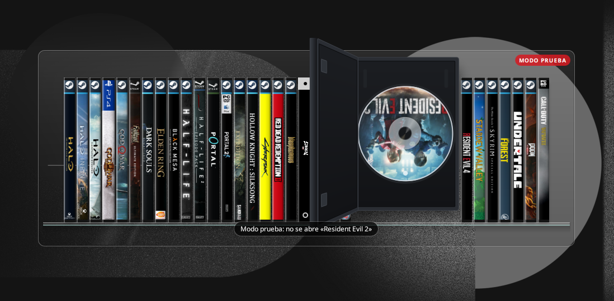

## Qué hace

- **Dos estilos.** Estantería (los lomos en repisas; la caja elegida se abre) o
  rocola (las portadas de frente, en fila).
- **La caja se abre y el disco gira** mientras el juego arranca. La duración de
  la animación se puede elegir o desactivar.
- **Juegos de Steam o de cualquier aplicación.** Los de Steam se abren con
  `steam://rungameid/…`; el resto, con su archivo `.desktop`. Puedes añadir
  varios `.desktop` de una vez.
- **Tu propio arte.** Lomo, portada, logo y portada del disco. Se puede recortar
  el arte de una caja completa (contraportada, lomo y portada en una imagen) o
  un disco a partir de una plantilla. Para los juegos de Steam, un botón toma
  la portada y el logo que Steam ya guarda en tu equipo.
- **Sonidos.** Al pasar de un juego a otro, abrir, jugar y cerrar. Cada disco
  puede tener su propio sonido, y cada momento puede usar un archivo tuyo.
- **Teclado y mando.** Con un atajo de teclado se abre la librería; se recorre
  con las flechas, Enter para jugar y Esc para salir. Con un mando, una
  combinación de botones la abre y la cruceta o el stick la recorren.
- **Solo despeja su monitor.** Mientras la librería está abierta, minimiza las
  ventanas del monitor donde está el widget (no las de los demás) y luego las
  devuelve. Durante la animación mantiene minimizada la ventana de Steam.
- **Exportar e importar** la lista de juegos a un archivo JSON.
- **Modo prueba:** todo funciona igual, pero no abre los juegos.

## Capturas

| Estantería | Rocola |
| --- | --- |
| 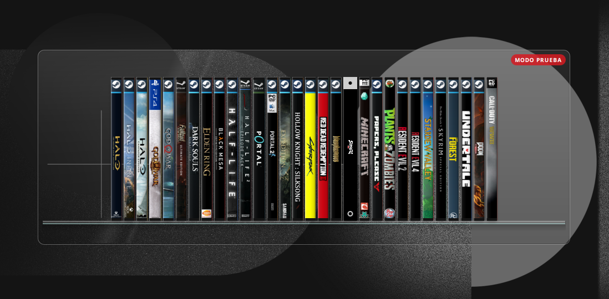 | 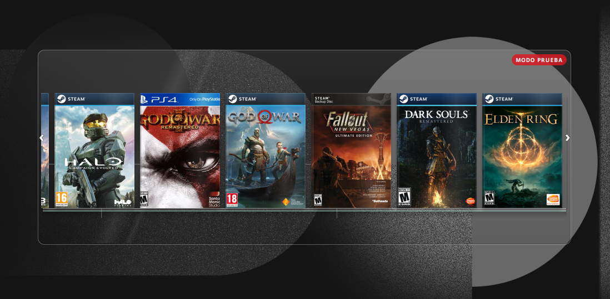 |
| 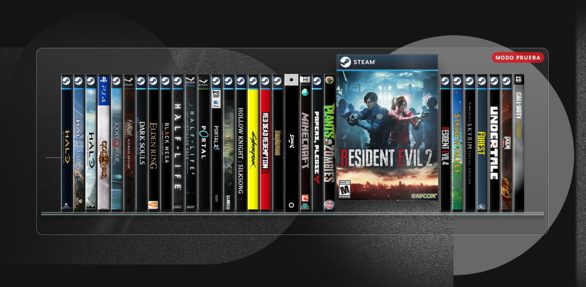 | 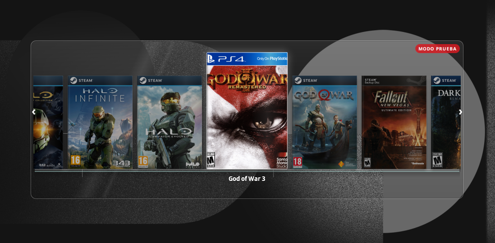 |
|  | 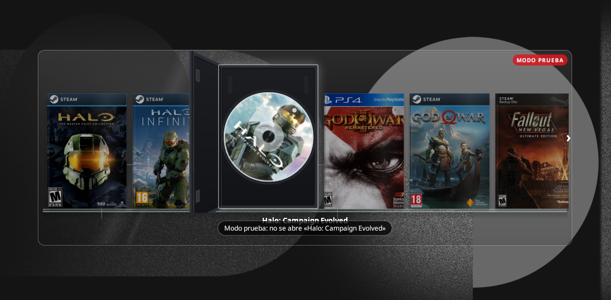 |

<details>
<summary><b>Ajustes (7 capturas)</b></summary>

**Juegos**

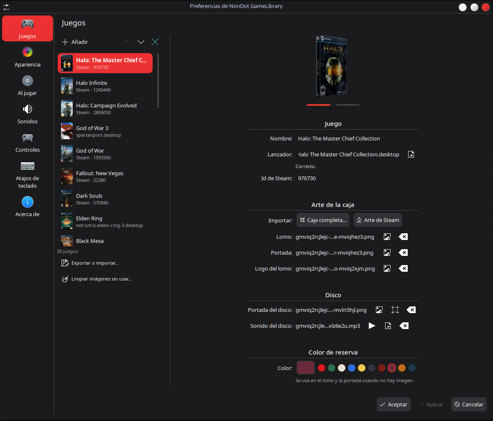

**Apariencia**

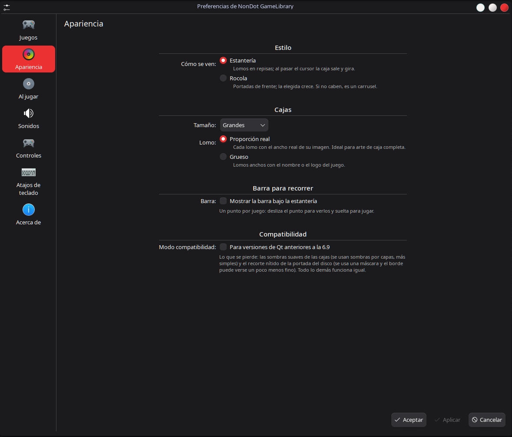

**Al jugar**

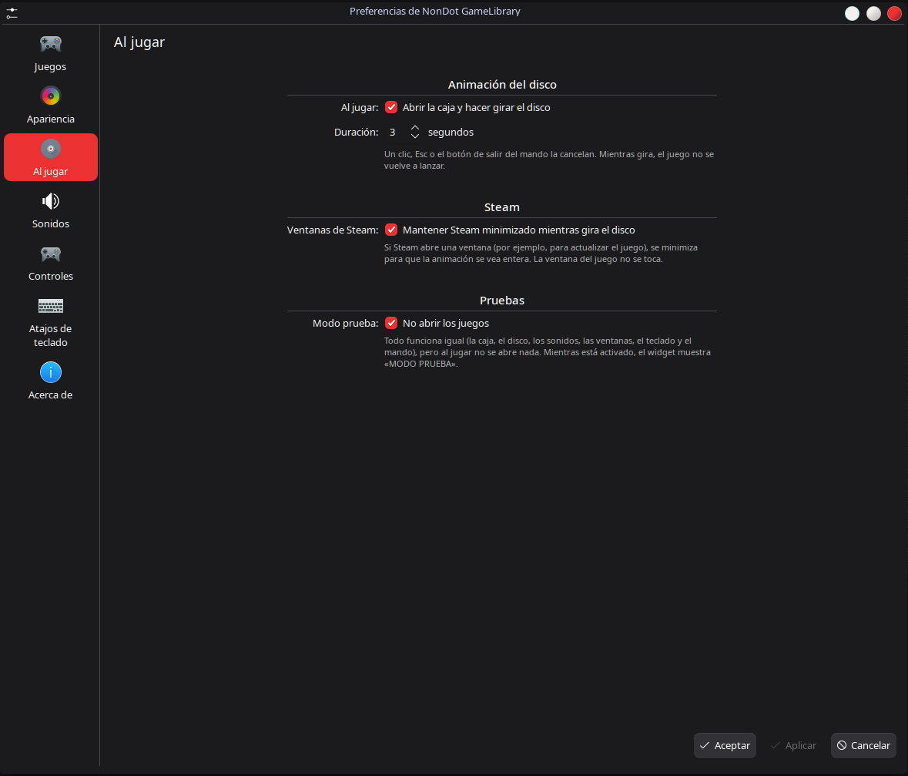

**Sonidos**

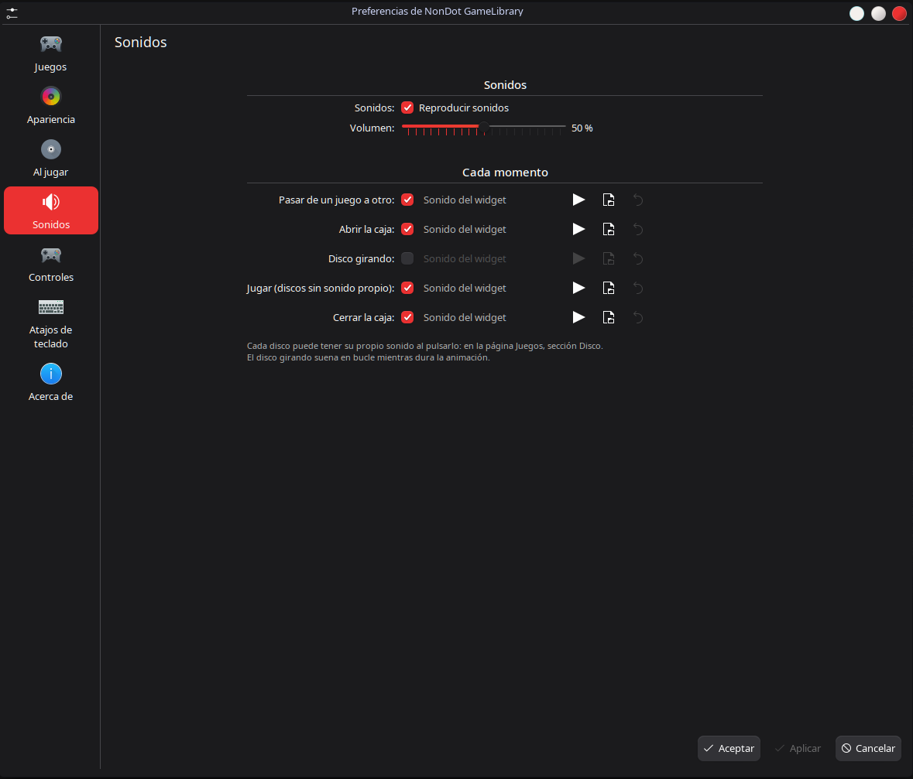

**Controles**

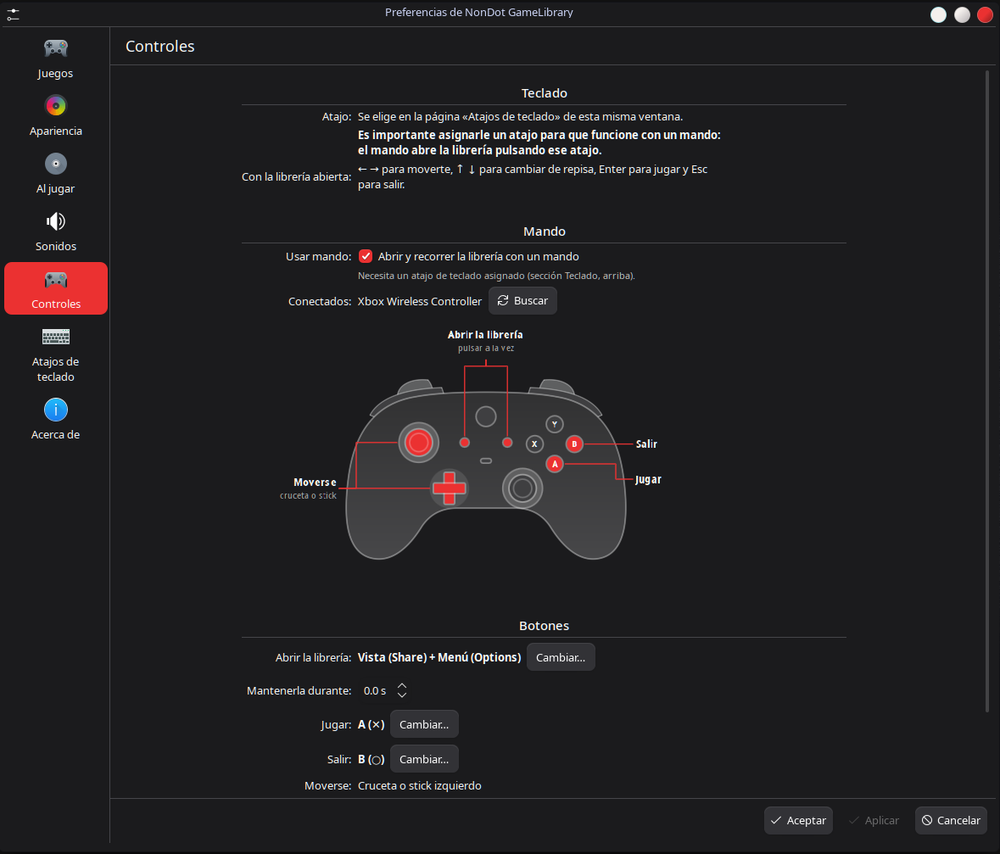

**Atajos de teclado**

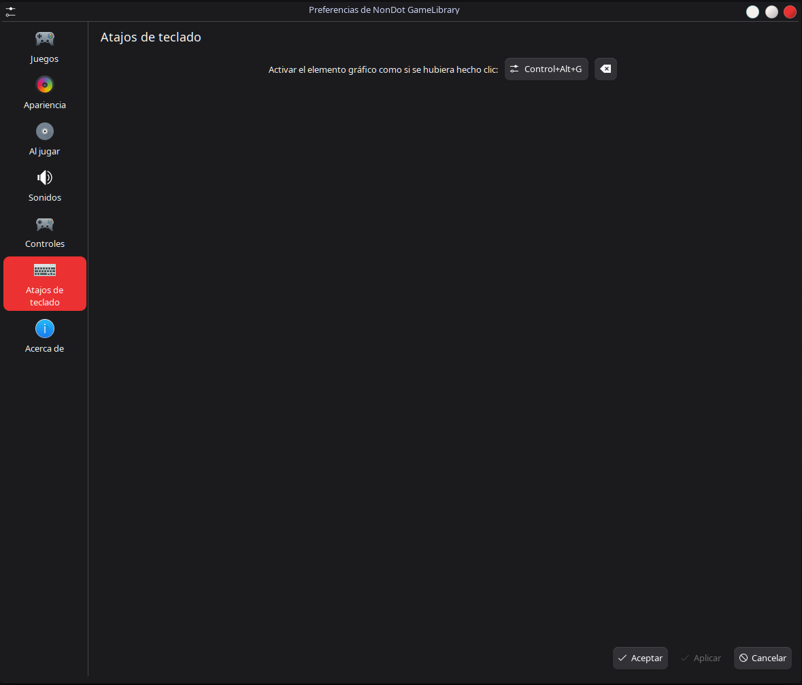

**Acerca de**

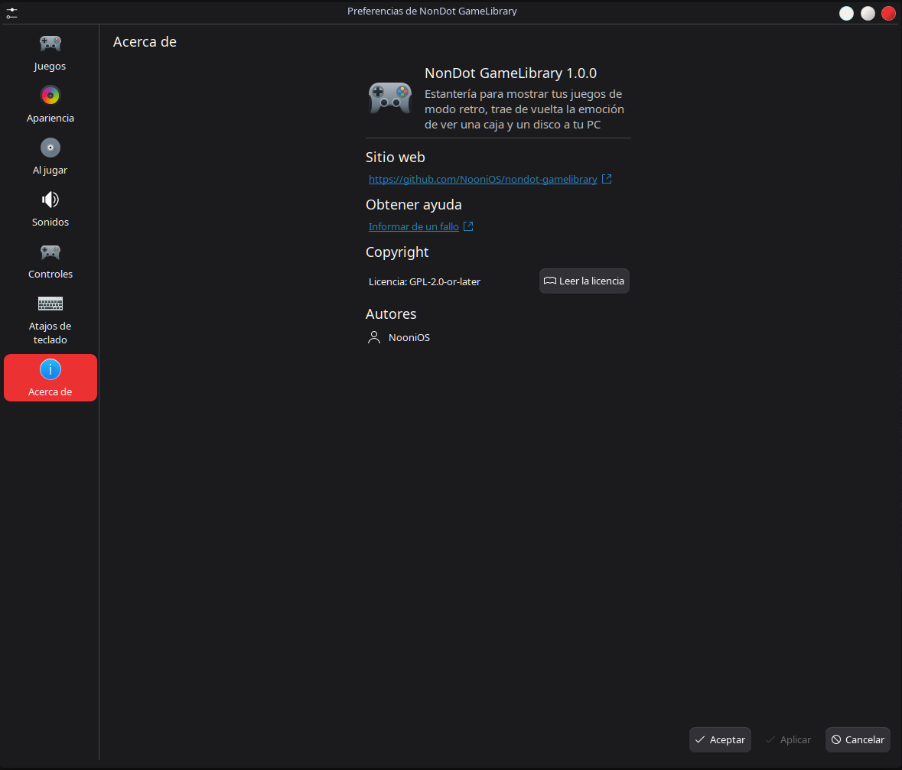

</details>

## Requisitos

- **KDE Plasma 6.**
- **Qt 6.9 o superior** para la mejor calidad (sombras suaves y disco recortado
  con borde fino). Con un Qt más antiguo, activa el **modo compatibilidad** en
  *Apariencia*: todo funciona igual, con sombras y bordes algo menos finos. Si
  el widget detecta que faltan las piezas modernas, cambia solo a la versión
  compatible.

Opcional:

- **Qt Multimedia** (paquete `qt6-multimedia` con su backend FFmpeg) para los
  sonidos. Sin él, el widget funciona en silencio.
- **Python 3** para el mando. El ayudante solo usa la biblioteca estándar y lee
  los mandos de `/dev/input/event*`, sin escribir nunca en ellos.
- **Steam**, si quieres añadir juegos de Steam.

Probado en CachyOS con Plasma 6.8 sobre Wayland y Qt 6.12.

## Instalación

Desde Plasma: en el panel para añadir elementos gráficos, descarga elementos
nuevos y busca «NonDot GameLibrary» (se instala desde la KDE Store).

O con el archivo `.plasmoid` de la página de versiones:

```bash
kpackagetool6 -t Plasma/Applet -i nondot-gamelibrary-1.0.0.plasmoid
```

Para actualizar, cambia `-i` por `-u`.

## Primeros pasos

1. Añade el widget al escritorio y pulsa **Añadir juegos…**.
2. En *Configurar… → Juegos*, añade un juego de Steam (con su id de Steam) o
   elige el `.desktop` de cualquier juego o aplicación.
3. Asígnale un atajo en *Configurar… → Atajos de teclado* (por ejemplo,
   Ctrl+Alt+G).

> **Importante para el mando:** el mando abre la librería pulsando ese atajo,
> así que sin atajo asignado no funciona. Actívalo en *Configurar → Controles*.

## Dónde guarda tus cosas

- La lista de juegos y los ajustes, en la configuración de Plasma, como
  cualquier widget.
- Las imágenes y los sonidos que eliges se copian a
  `~/.local/share/nondot-gamelibrary`, para que no se pierdan si mueves el
  original. *Juegos → Limpiar imágenes sin usar…* borra las copias que ya no usa
  ningún juego.
- Un script temporal de KWin en `~/.cache/nondot-gamelibrary` mientras la
  librería está abierta.

El widget no se conecta a internet.

## Desarrollo

```
package/   el widget (metadata.json y contents/)
po/        traducciones (template.pot y un .po por idioma)
tests/     pruebas automáticas (qmltestrunner)
tools/     empaquetado, traducciones y generador de sonidos
```

Crear el `.plasmoid`:

```bash
python3 tools/pack.py
```

Pasar las pruebas (sin abrir ventanas):

```bash
for t in tests/tst_*.qml; do QT_QPA_PLATFORM=offscreen /usr/lib/qt6/bin/qmltestrunner -input "$t"; done
```

Los textos del widget están en inglés. Para añadir o actualizar una traducción,
crea o edita `po/<idioma>.po` y ejecuta (necesita gettext):

```bash
python3 tools/translations.py
```

Extrae los textos a `po/template.pot`, actualiza cada `.po` y los compila en
`package/contents/locale`.

Los sonidos de `package/contents/sounds` son originales: los genera
`tools/make_sounds.py`.

## Licencia

GPL-2.0-or-later. Consulta [LICENSE](LICENSE).
